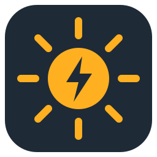
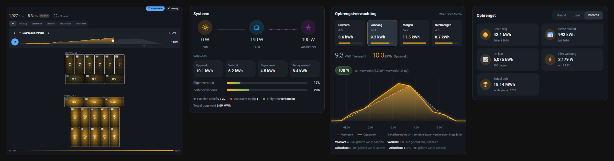

<h1> Enphase Envoy Local</h1>

Je Enphase-zonnepanelen live en lokaal in Home Assistant: elk paneel op zijn echte plek op het dak (de paneelindeling komt automatisch uit Enphase Enlighten), een opbrengstverwachting die van je eigen panelen leert, het Energiedashboard en negen kaarten in twee stijlen. De metingen gaan nooit via de cloud.

**Taal / Language / Sprache:** [Nederlands](#nederlands) · [English](#english) · [Deutsch](#deutsch)

## Nederlands

### Wat het doet

- **Lokaal uitlezen.** De integratie leest je Enphase IQ Gateway (Envoy) elke 10 seconden rechtstreeks in je eigen netwerk uit. Enlighten wordt alleen gebruikt om het token op te halen en automatisch te vernieuwen dat firmware 7 en nieuwer nodig heeft.
- **Paneelindeling uit Enlighten.** Elk paneel staat op zijn echte plek op het dak, met live vermogen, temperatuur, rendement en gezondheid. Heeft de installateur geen plattegrond getekend, dan leg je de panelen zelf neer.
- **Live per paneel.** Micro-omvormers melden zich maar ongeveer elke 15 minuten. Daartussen schat de integratie het vermogen van elk paneel live: met een productiemeter uit de meting van elke 10 seconden, zonder meter uit het verwachte zonverloop. Uit te zetten in de opties.
- **Elk paneel bewaakt.** Elk paneel wordt vergeleken met de goede panelen op hetzelfde dakvlak. Blijft er een achter of geeft het niets, dan krijg je een melding onder *Instellingen → Reparaties*.
- **Opbrengstverwachting.** Weer van Open-Meteo (gratis, geen account), uitgerekend per dakvlak en geleerd van een jaar eigen productie: richting, hellingshoek, schaduw, paneeltemperatuur en seizoen. Ook in het Energiedashboard.
- **Opbrengst in euro's.** Met de day-ahead prijs (EPEX SPOT) van elk kwartier, die de integratie zelf ophaalt: wat je vandaag, deze maand, dit jaar en in totaal bespaart door eigen verbruik en verdient met teruglevering, de stroomprijs nu, de gemiddelde waarde per kWh en (met je investering) de terugverdientijd. Salderen of dynamisch terugleveren, met opslag, energiebelasting en btw. Het verleden wordt aangevuld uit je statistieken. Melding bij teruglevering tegen een negatieve prijs. Instellen onder *Configureren → Opbrengst in euro's*.
- **Net en fasen.** Spanning, stroom, arbeidsfactor, blind- en schijnbaar vermogen per fase, netfrequentie, hoogste en laagste spanning van vandaag.
- **Geen CT's? Koppel je eigen meters.** Onder *Configureren → Eigen meters* kies je bijvoorbeeld een Shelly op de zonnepanelengroep, een Shelly 3EM of een P1-meter. De integratie maakt dan dezelfde entiteiten als met CT's: productie, verbruik, netafname en teruglevering, eigen verbruik, zelfvoorzienend en de live schatting per paneel. Je koppelt alleen de vermogenssensor; spanning, stroom, arbeidsfactor, schijnbaar en blindvermogen en frequentie van dezelfde meter worden vanzelf gevonden, dus ook de netkaart, cos φ en het glas bier werken. Een 1-fase meter is genoeg. De cos φ- en bierkaart kun je ook los aan een Shelly koppelen (*Eigen meter* in de kaarteditor).
- **Energiedashboard zonder P1-meter.** Productie, netafname en teruglevering komen rechtstreeks uit de meters van de gateway.
- Nederlands, Engels en Duits.

### Installatie

1. Installeer **Enphase Envoy Local** via HACS (knop hierboven) en herstart Home Assistant.
2. Ga naar *Instellingen → Apparaten & diensten*: je gateway staat meestal al onder *Ontdekt* (of gebruik de tweede knop).
3. Vul je Enlighten-e-mail en -wachtwoord in. Klaar.

Geef de gateway een vast IP-adres in je router. Accounts met tweestapsverificatie plakken een token van entrez.enphaseenergy.com in plaats van het wachtwoord.

### De kaarten

De kaarten worden automatisch geladen; zoek in de kaartkiezer op **"Enphase"**. Elke kaart heeft in de editor een **stijl** (*Clean* of *Classic*), een **grootte** (klein, middel, groot, volle breedte) en een **hoogte**.

**Paneelindeling** · `custom:enphase-panel-layout-card`

Elk paneel op het dak. Weergaven *Nu, Vandaag, Gezondheid, Schaduw, Temperatuur* en *Rendement*. Met ▶ speel je elke dag af: je ziet de zon over het dak trekken, met de verwachting als stippellijn. Met ✎ *Indeling* sleep je de panelen zelf op hun plek.

**Systeem** · `custom:enphase-system-card` — zon, huis en net met live vermogen, vandaag opgewekt, verbruikt, afgenomen en teruggeleverd, eigen verbruik en zelfvoorzienend.

**Verwachting** · `custom:enphase-forecast-card` — gisteren tot overmorgen, per uur verwacht tegenover opgewekt, en de geleerde richting van elk dakvlak.

**Net & fasen** · `custom:enphase-grid-card` — spanningsmeter per fase met de grenzen 207–253 V, stroom, arbeidsfactor en afname of teruglevering per fase.

**Opbrengst** · `custom:enphase-energy-card` — kalender met de opbrengst van elke dag, maanden tegenover vorig jaar, en records (beste dag, beste maand, dit jaar, totaal).

**Opbrengst** · `custom:enphase-earnings-card` — wat je panelen vandaag, deze maand, dit jaar en in totaal opleveren in euro's, met de stroomprijs van vandaag per kwartier.

**Micro-omvormers** · `custom:enphase-inverters-card` — alle omvormers in één sorteerbare tabel.

**Arbeidsfactor** · `custom:enphase-power-factor-card` — de vermogensdriehoek op de eenheidscirkel, live, voor het net, per fase of voor de zon.

**cos φ in een glas bier** · `custom:enphase-beer-card` — het bier is het werkelijk vermogen, het schuim het blindvermogen en het hele glas het schijnbaar vermogen. cos φ = bier ÷ glas. Schuim en belletjes bewegen live mee.

### Entiteiten

- **Gateway:** productie nu, vandaag, gisteren en totaal; verbruik, netafname en teruglevering (met verbruiks-CT's); eigen verbruik en zelfvoorzienend; netfrequentie en arbeidsfactor; Enlighten-verbinding en exportlimiet.
- **Per fase:** spanning, stroom, vermogen en arbeidsfactor van productie, verbruik en net.
- **Per micro-omvormer:** AC- en DC-vermogen, rendement, DC-spanning en -stroom, temperatuur, productie vandaag/gisteren/week/totaal, prestatie t.o.v. het dakvlak, presteert onder, geen opbrengst.
- **Verwachting:** vandaag, morgen, overmorgen, rest van vandaag, vermogen nu, komend uur, beste uur morgen, opbrengst t.o.v. verwachting en nauwkeurigheid van gisteren.
- **Voor de nerds:** piekproductie, hoogste en laagste spanning en frequentie van vandaag, minuten boven 250 V, blind- en schijnbaar vermogen, fase-onbalans, spanningsverschil tussen fasen, zonnestroom direct gebruikt, DC-vermogen, omzettingsverlies, zwakste paneel, omvormertemperaturen en reactietijd van de gateway. Binaire sensor *Netspanning hoog*.
- **Knoppen:** nu verversen, token vernieuwen, paneelindeling ophalen.

### Hoe goed is de verwachting?

Getest op een echt oost/west-systeem van 22 panelen, de laatste 50 dagen, elke dag alleen geleerd van de dagen ervoor: **10,5 % afwijking per dag, zonder vertekening.** Het weer komt van het gemiddelde van drie modellen (DWD ICON, ECMWF en Météo-France). De rest van de afwijking is het weer zelf: als de modellen een wolkenveld verkeerd hebben, zit de verwachting er ook naast. De locatie van Home Assistant wordt naar Open-Meteo gestuurd; zet de optie uit als je dat niet wilt.

### Goed om te weten

- Met een eigenaarstoken weigert de gateway de productie te stoppen of de exportlimiet te wijzigen; dat mag alleen een installateur.
- Zet dezelfde gateway niet ook in de ingebouwde Enphase Envoy-integratie: dat geeft dubbele belasting.
- Geen paneelindeling? Ingesteld met alleen een token: kies *Herconfigureren* en voeg e-mail en wachtwoord toe, of leg de panelen zelf neer.
- Kaarten niet zichtbaar na een update: één keer Ctrl+F5, of de app opnieuw starten.
- Bij een probleem: download de diagnose op de apparaatpagina (wachtwoorden en tokens zijn eruit gehaald).

## English

Your Enphase panels live and local in Home Assistant: every panel in its real place on the roof (the panel layout comes from Enphase Enlighten automatically), a solar forecast that learns from your own panels, the Energy dashboard and nine cards in two styles. Measurements never go through the cloud.

### What it does

- **Local readings** from your Enphase IQ Gateway (Envoy) every 10 seconds. Enlighten is only used to get and renew the token that firmware 7 and newer require.
- **Panel layout from Enlighten**, with live power, temperature, efficiency and health per panel. No layout in Enlighten? Arrange the panels yourself.
- **Live per panel.** Microinverters only report about every 15 minutes. In between the integration estimates every panel live: from the production meter (every 10 s) when there is one, otherwise from the expected solar curve. Can be turned off in the options.
- **Every panel monitored** against the good panels on the same roof surface, with repair notices when one falls behind or gives nothing.
- **Solar forecast** from Open-Meteo, computed per roof surface and learned from a year of your own production (orientation, tilt, shade, panel temperature, season). Also in the Energy dashboard. Backtested: 10.5 % error per day, no bias.
- **Earnings in euro** with the day-ahead price (EPEX SPOT) of every quarter hour, fetched by the integration itself: savings by self-use and export revenue today, this month, this year and in total, the price now, the average value per kWh and the payback time. Net metering or dynamic export, with markup, energy tax and VAT. The past is filled in from your statistics. Alert when exporting at a negative price.
- **Grid and phases:** voltage, current, power factor, reactive and apparent power per phase, frequency, today's extremes.
- **No CTs? Link your own meters** under *Configure → Own meters* (a Shelly on the solar group, a Shelly 3EM, a P1 meter): the integration then creates the same entities as with CTs, including the live estimate per panel. Link only the power sensor: voltage, current, power factor, apparent/reactive power and frequency of the same meter are found automatically, so the grid card, cos φ and the beer glass work too. A single-phase meter is enough.
- **Energy dashboard without a P1 meter:** production, import and export straight from the gateway's meters.

### Installation

1. Install **Enphase Envoy Local** through HACS (button above) and restart Home Assistant.
2. Open *Settings → Devices & services*: your gateway is usually listed under *Discovered* (or use the second button).
3. Enter your Enlighten e-mail and password. Done.

### The cards

Search for **"Enphase"** in the card picker: panel layout (with day replay), system, forecast, grid & phases, production history, microinverters, power factor and cos φ in a glass of beer. Every card has a style (*Clean* or *Classic*), size and height setting in its editor.

### Good to know

- With an owner token the gateway refuses to stop production or change the export limit; only installers may do that.
- Do not set up the same gateway in the built-in Enphase Envoy integration as well.
- Cards not showing after an update: press Ctrl+F5 once, or restart the app.
- When reporting a problem, add the diagnostics from the device page (passwords and tokens are removed).

## Deutsch

Deine Enphase-Module live und lokal in Home Assistant: jedes Modul an seinem echten Platz auf dem Dach (die Modulanordnung kommt automatisch aus Enphase Enlighten), eine Ertragsprognose, die von deinen eigenen Modulen lernt, das Energie-Dashboard und neun Karten in zwei Stilen. Die Messwerte gehen nie über die Cloud.

### Was es macht

- **Lokales Auslesen** deines Enphase IQ Gateway (Envoy) alle 10 Sekunden. Enlighten wird nur für das Token genutzt, das Firmware 7 und neuer verlangt.
- **Modulanordnung aus Enlighten**, mit Live-Leistung, Temperatur, Wirkungsgrad und Zustand je Modul. Kein Plan in Enlighten? Dann ordnest du die Module selbst an.
- **Live je Modul.** Mikrowechselrichter melden sich nur etwa alle 15 Minuten. Dazwischen schätzt die Integration jedes Modul live: mit Erzeugungszähler aus dessen Messung (alle 10 s), sonst aus dem erwarteten Sonnenverlauf. In den Optionen abschaltbar.
- **Jedes Modul überwacht** gegenüber den guten Modulen derselben Dachfläche, mit Reparaturhinweisen, wenn eines zurückbleibt.
- **Ertragsprognose** von Open-Meteo, je Dachfläche berechnet und aus einem Jahr eigener Erzeugung gelernt (Ausrichtung, Neigung, Schatten, Modultemperatur, Jahreszeit). Auch im Energie-Dashboard. Getestet: 10,5 % Abweichung pro Tag, ohne systematischen Fehler.
- **Ertrag in Euro** mit dem Day-Ahead-Preis (EPEX SPOT) jeder Viertelstunde, den die Integration selbst abruft: Ersparnis durch Eigenverbrauch und Einspeiseerlös heute, diesen Monat, dieses Jahr und gesamt, der Preis jetzt, der Durchschnittswert je kWh und die Amortisationszeit. Saldierung oder dynamische Einspeisung, mit Aufschlag, Energiesteuer und MwSt. Die Vergangenheit wird aus deinen Statistiken ergänzt. Hinweis bei Einspeisung zu negativem Preis.
- **Netz und Phasen:** Spannung, Strom, Leistungsfaktor, Blind- und Scheinleistung je Phase, Frequenz, Extremwerte von heute.
- **Keine Stromwandler? Eigene Zähler verknüpfen** unter *Konfigurieren → Eigene Zähler* (Shelly am Solarkreis, Shelly 3EM, Smart-Meter-Leser): die Integration erstellt dann dieselben Entitäten wie mit Stromwandlern, inklusive Live-Schätzung je Modul. Nur den Leistungssensor verknüpfen: Spannung, Strom, Leistungsfaktor, Schein-/Blindleistung und Frequenz desselben Zählers werden automatisch gefunden, also funktionieren auch Netzkarte, cos φ und Bierglas. Ein einphasiger Zähler reicht.
- **Energie-Dashboard ohne Smart-Meter-Leser:** Erzeugung, Bezug und Einspeisung direkt aus den Zählern des Gateways.

### Installation

1. **Enphase Envoy Local** über HACS installieren (Taste oben) und Home Assistant neu starten.
2. *Einstellungen → Geräte & Dienste* öffnen: dein Gateway steht meist schon unter *Entdeckt* (oder die zweite Taste nutzen).
3. Enlighten-E-Mail und -Passwort eingeben. Fertig.

### Die Karten

Suche in der Kartenauswahl nach **„Enphase“**: Modulanordnung (mit Tagesablauf), System, Prognose, Netz & Phasen, Ertragshistorie, Mikrowechselrichter, Leistungsfaktor und cos φ im Bierglas. Jede Karte hat im Editor einen Stil (*Clean* oder *Classic*), eine Größen- und eine Höheneinstellung.

### Gut zu wissen

- Mit einem Eigentümer-Token verweigert das Gateway das Abschalten der Erzeugung oder das Ändern des Einspeiselimits; das darf nur ein Installateur.
- Richte dasselbe Gateway nicht zusätzlich in der eingebauten Enphase-Envoy-Integration ein.
- Karten nach einem Update nicht sichtbar: einmal Strg+F5 drücken oder die App neu starten.
- Bei Problemen die Diagnose von der Geräteseite anhängen (Passwörter und Tokens werden entfernt).

## Licentie / License / Lizenz

MIT. Dit project is niet verbonden aan Enphase Energy. "Enphase", "Envoy" en "Enlighten" zijn handelsmerken van Enphase Energy, Inc.
