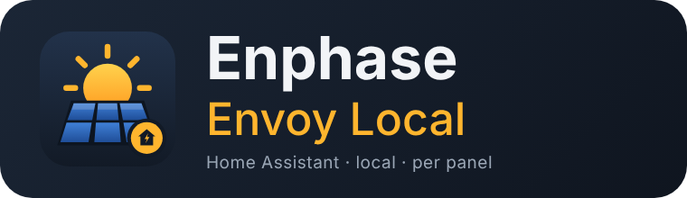
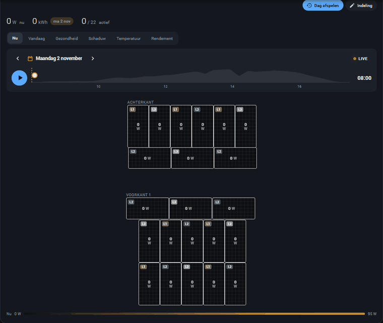
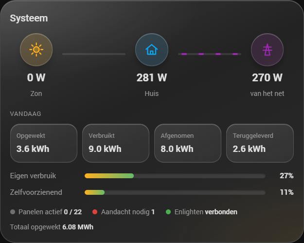
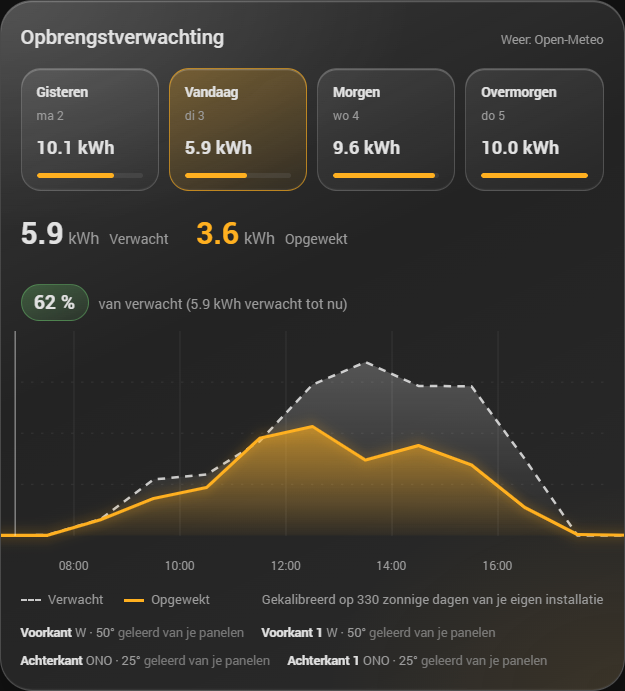
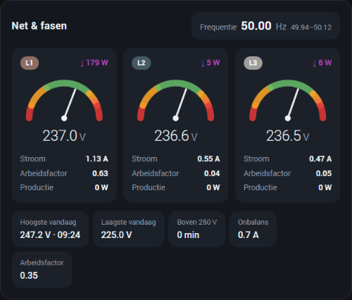
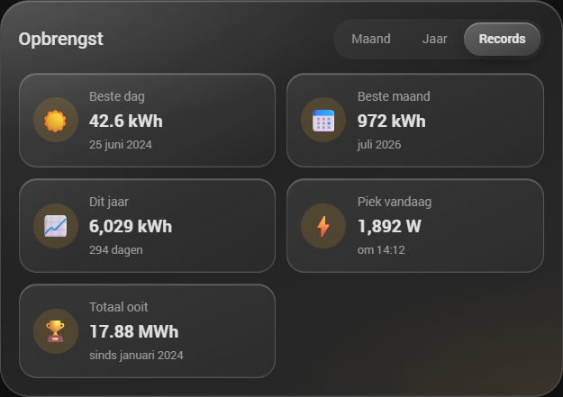
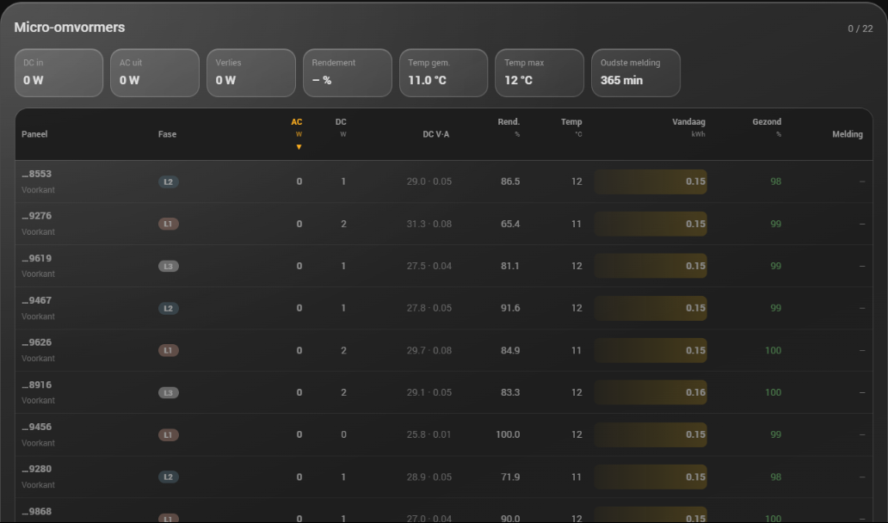
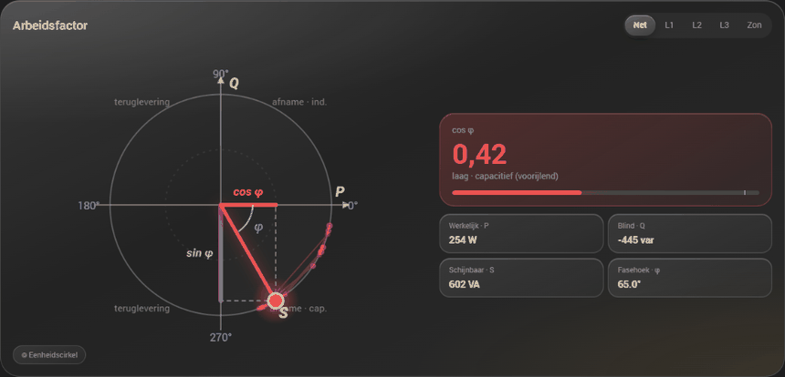
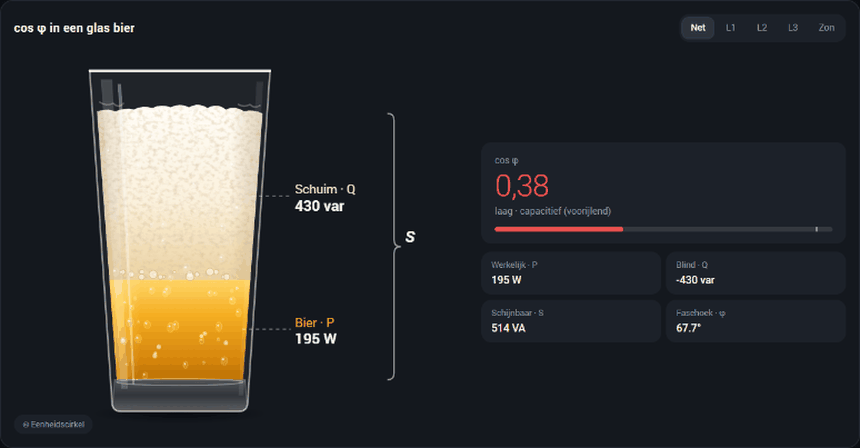

<p align="center">
  
</p>

<p align="center">
  <a href="https://my.home-assistant.io/redirect/hacs_repository/?owner=George-120&repository=ha-enphase-envoy-local&category=integration"></a>
  <a href="https://my.home-assistant.io/redirect/config_flow_start/?domain=enphase_envoy_local"></a>
</p>

<p align="center">
  <a href="https://hacs.xyz/"></a>
  <a href="https://github.com/George-120/ha-enphase-envoy-local/releases"></a>
  
</p>

<p align="center">
  <b><a href="#-nederlands">🇳🇱 Nederlands</a></b> ·
  <b><a href="#-english">🇬🇧 English</a></b> ·
  <b><a href="#-deutsch">🇩🇪 Deutsch</a></b>
</p>

---

> 🇳🇱 **Je Enphase-zonnepanelen helemaal lokaal in Home Assistant.** De integratie leest je Enphase IQ Gateway
> (Envoy) rechtstreeks in je eigen netwerk uit, elke 10 seconden en zonder cloud. Ze **haalt de paneelindeling
> automatisch uit Enphase Enlighten**, zodat elk paneel op zijn echte plek op het dak staat, met live vermogen,
> temperatuur, rendement en gezondheid per paneel. Daarbij: een eigen, op jouw panelen geleerde
> **opbrengstverwachting**, het **Energiedashboard**, netspanning en arbeidsfactor per fase, meldingen bij een
> slecht paneel en negen kaarten. Geen plattegrond in Enlighten? Dan leg je de panelen zelf neer.
>
> 🇬🇧 **Your Enphase solar panels fully local in Home Assistant.** The integration reads your Enphase IQ Gateway
> (Envoy) directly on your own network, every 10 seconds and without the cloud. It **fetches the panel layout
> automatically from Enphase Enlighten**, so every panel is in its real place on the roof, with live power,
> temperature, efficiency and health per panel. On top of that: its own **solar forecast** learned from your
> panels, the **Energy dashboard**, grid voltage and power factor per phase, alerts for a bad panel and nine
> cards. No layout in Enlighten? Arrange the panels yourself.
>
> 🇩🇪 **Deine Enphase-Solarmodule komplett lokal in Home Assistant.** Die Integration liest dein Enphase IQ Gateway
> (Envoy) direkt in deinem Netzwerk aus, alle 10 Sekunden und ohne Cloud. Sie **holt die Modulanordnung
> automatisch aus Enphase Enlighten**, sodass jedes Modul an seinem echten Platz auf dem Dach liegt, mit
> Live-Leistung, Temperatur, Wirkungsgrad und Zustand je Modul. Dazu: eine eigene, an deinen Modulen gelernte
> **Ertragsprognose**, das **Energie-Dashboard**, Netzspannung und Leistungsfaktor je Phase, Hinweise bei einem
> schwachen Modul und neun Karten. Kein Plan in Enlighten? Dann ordnest du die Module selbst an.

## ☀️ The day on your roof · De dag op je dak · Der Tag auf deinem Dach



> 🇳🇱 **Paneelindeling – dag afspelen.** Elk paneel ligt op zijn echte plek op het dak. Druk op ▶ en de dag
> speelt af: je ziet de zon over het dak trekken, eerst de achterkant en daarna de voorkant. Bovenaan staat het
> vermogen en de kWh tot dat moment, de gestippelde lijn is de verwachting. Kies elke dag uit de kalender
> en wissel tijdens het afspelen tussen *Nu, Vandaag, Gezondheid, Schaduw, Temperatuur* en *Rendement*.
>
> 🇬🇧 **Panel layout – day replay.** Every panel lies where it really is on the roof. Press ▶ and the day plays:
> the sun moves over the roof, first the back and then the front. At the top: power and kWh up to that moment;
> the dashed line is the forecast. Pick any day from the calendar and switch between *Now, Today, Health,
> Shade, Temperature* and *Efficiency* while it plays.
>
> 🇩🇪 **Modulanordnung – Tag abspielen.** Jedes Modul liegt an seinem echten Platz auf dem Dach. Drück ▶ und der
> Tag läuft ab: die Sonne wandert über das Dach, erst die Rückseite, dann die Vorderseite. Oben Leistung und kWh
> bis zu diesem Moment, die gestrichelte Linie ist die Prognose. Wähle jeden Tag im Kalender und wechsle beim
> Abspielen zwischen *Jetzt, Heute, Zustand, Schatten, Temperatur* und *Wirkungsgrad*.

## 🧩 The cards · De kaarten · Die Karten

All cards are added to Home Assistant automatically; search for **"Enphase"** in the card picker. Every card
has a visual editor with **Size** (Small, Medium, Large, Full width) and **Height**.

### System · Systeem · System



> 🇳🇱 **Systeemkaart** – zon → huis ↔ net met live vermogen en bewegende stroomlijnen, en wat er vandaag is
> opgewekt, verbruikt, afgenomen en teruggeleverd. Twee balken tonen *eigen verbruik* (hoeveel van je zonnestroom
> je zelf gebruikt) en *zelfvoorzienend* (hoeveel van je verbruik uit eigen zon komt). Onderaan: actieve panelen,
> meldingen en de Enlighten-verbinding.
>
> 🇬🇧 **System card** – solar → home ↔ grid with live power and animated flow, plus today's production, use,
> import and export. Two bars show *self-consumption* (how much of your solar you use yourself) and
> *self-sufficiency* (how much of your use comes from your own sun). At the bottom: panels producing, alerts and
> the Enlighten connection.
>
> 🇩🇪 **Systemkarte** – Sonne → Haus ↔ Netz mit Live-Leistung und animiertem Fluss, dazu Erzeugung, Verbrauch,
> Bezug und Einspeisung von heute. Zwei Balken zeigen *Eigenverbrauch* (wie viel Solarstrom du selbst nutzt) und
> *Autarkie* (wie viel deines Verbrauchs aus eigener Sonne kommt). Unten: aktive Module, Meldungen und die
> Enlighten-Verbindung.

```yaml
type: custom:enphase-system-card
```

### Solar forecast · Opbrengstverwachting · Ertragsprognose



> 🇳🇱 **Verwachting** – gisteren, vandaag, morgen en overmorgen als tegels, en per uur *verwacht* (gestippeld)
> tegenover *opgewekt*. Het percentage zegt hoe ver je vandaag voor of achter loopt. Onderaan staat per dakvlak
> de richting en hellingshoek die de integratie zelf heeft geleerd. Zie [Hoe werkt de verwachting?](#hoe-werkt-de-verwachting).
>
> 🇬🇧 **Forecast** – yesterday, today, tomorrow and the day after as tiles, and *expected* (dashed) against
> *produced* per hour. The percentage tells how far ahead or behind today is. At the bottom, the orientation and
> tilt the integration learned for every roof surface. See [How the forecast works](#how-the-forecast-works).
>
> 🇩🇪 **Prognose** – gestern, heute, morgen und übermorgen als Kacheln und stündlich *erwartet* (gestrichelt)
> gegen *erzeugt*. Der Prozentwert zeigt, wie weit du heute vor oder hinter der Prognose liegst. Unten die
> Ausrichtung und Neigung, die die Integration für jede Dachfläche gelernt hat. Siehe
> [So funktioniert die Prognose](#so-funktioniert-die-prognose).

```yaml
type: custom:enphase-forecast-card
```

### Grid & phases · Net & fasen · Netz & Phasen



> 🇳🇱 **Net & fasen** – per fase een spanningsmeter met de grenzen van het net (207–253 V; boven 253 V
> schakelen omvormers af), stroom, arbeidsfactor, productie en of je die fase afneemt (↓) of teruglevert (↑).
> Daaronder de hoogste en laagste spanning van vandaag, minuten boven 250 V, fase-onbalans en de
> netfrequentie met het bereik van vandaag.
>
> 🇬🇧 **Grid & phases** – a voltage gauge per phase with the grid limits (207–253 V; above 253 V inverters
> disconnect), current, power factor, production and whether that phase imports (↓) or exports (↑). Below:
> today's highest and lowest voltage, minutes above 250 V, phase imbalance and the grid frequency with today's
> range.
>
> 🇩🇪 **Netz & Phasen** – je Phase ein Spannungsmesser mit den Netzgrenzen (207–253 V; über 253 V schalten
> Wechselrichter ab), Strom, Leistungsfaktor, Erzeugung und ob die Phase bezieht (↓) oder einspeist (↑).
> Darunter höchste und niedrigste Spannung heute, Minuten über 250 V, Phasenschieflast und die Netzfrequenz mit
> dem heutigen Bereich.

```yaml
type: custom:enphase-grid-card
```

### Production history · Opbrengst · Ertragshistorie



> 🇳🇱 **Opbrengst** – een kalender met de opbrengst van elke dag (de gele balk vult zich naar verhouding), de
> maanden van dit jaar naast vorig jaar, en **records**: beste dag, beste maand, dit jaar, piek vandaag en het
> totaal. De gegevens komen uit de langetermijnstatistieken van Home Assistant, ook van vóór de installatie.
> Dagen waarop de tellerstand van de gateway is versprongen, worden uit de uurwaarden opnieuw opgebouwd.
>
> 🇬🇧 **History** – a calendar with the production of every day (the yellow bar fills in proportion), the months
> of this year next to last year, and **records**: best day, best month, this year, peak today and the total. The
> data comes from Home Assistant's long-term statistics, including from before you installed this integration.
> Days on which the gateway's counter jumped are rebuilt from the hourly values.
>
> 🇩🇪 **Ertrag** – ein Kalender mit dem Ertrag jedes Tages (der gelbe Balken füllt sich anteilig), die Monate
> dieses Jahres neben dem Vorjahr und **Rekorde**: bester Tag, bester Monat, dieses Jahr, Spitze heute und
> gesamt. Die Daten stammen aus den Langzeitstatistiken von Home Assistant, auch von vor der Installation. Tage, an
> denen der Zähler des Gateways gesprungen ist, werden aus den Stundenwerten neu aufgebaut.

```yaml
type: custom:enphase-energy-card
```

### Microinverters · Micro-omvormers · Mikrowechselrichter



> 🇳🇱 **Micro-omvormers** – alle omvormers in één sorteerbare tabel: AC- en DC-vermogen, DC-spanning en
> -stroom, rendement, temperatuur, vandaag, gezondheid t.o.v. het dakvlak en hoe lang geleden de laatste melding
> was. Bovenaan de totalen: DC in, AC uit, omzettingsverlies, rendement en temperaturen.
>
> 🇬🇧 **Microinverters** – every microinverter in one sortable table: AC and DC power, DC voltage and current,
> efficiency, temperature, today, health against the roof surface and minutes since the last report. At the top
> the totals: DC in, AC out, conversion losses, efficiency and temperatures.
>
> 🇩🇪 **Mikrowechselrichter** – alle Wechselrichter in einer sortierbaren Tabelle: AC- und DC-Leistung,
> DC-Spannung und -Strom, Wirkungsgrad, Temperatur, heute, Zustand gegenüber der Dachfläche und Minuten seit der
> letzten Meldung. Oben die Summen: DC rein, AC raus, Umwandlungsverlust, Wirkungsgrad und Temperaturen.

```yaml
type: custom:enphase-inverters-card
```

### Power factor (cos φ) · Arbeidsfactor · Leistungsfaktor



> 🇳🇱 **Arbeidsfactor** – de vermogensdriehoek op de eenheidscirkel, live. Horizontaal het werkelijk vermogen
> P, verticaal het blindvermogen Q, de pijl is het schijnbaar vermogen S. De oranje lijn is cos φ, de paarse
> sin φ; het spoor laat zien waar de pijl de afgelopen uren was. Kies *Net, L1, L2, L3* of *Zon*. Rechts:
> inductief of capacitief, en P, Q, S en de fasehoek.
>
> 🇬🇧 **Power factor** – the power triangle on the unit circle, live. Horizontal the active power P, vertical
> the reactive power Q, the arrow is the apparent power S. The orange line is cos φ, the purple one sin φ; the
> trail shows where the arrow was over the last hours. Choose *Grid, L1, L2, L3* or *Solar*. On the right:
> inductive or capacitive, and P, Q, S and the phase angle.
>
> 🇩🇪 **Leistungsfaktor** – das Leistungsdreieck auf dem Einheitskreis, live. Waagerecht die Wirkleistung P,
> senkrecht die Blindleistung Q, der Pfeil ist die Scheinleistung S. Die orange Linie ist cos φ, die violette
> sin φ; die Spur zeigt, wo der Pfeil in den letzten Stunden war. Wähle *Netz, L1, L2, L3* oder *Sonne*. Rechts:
> induktiv oder kapazitiv sowie P, Q, S und der Phasenwinkel.

```yaml
type: custom:enphase-power-factor-card
source: grid      # grid | L1 | L2 | L3 | production
scale: unit       # unit (unit circle) | power (arrow length = S)
hours: 2          # trail, 0 = off
```

### cos φ in a glass of beer · in een glas bier · in einem Glas Bier



> 🇳🇱 **cos φ in een glas bier** – de bekende uitleg: het **bier** is het werkelijk vermogen (wat echt werk
> doet), het **schuim** is het blindvermogen, en het **hele glas** is het schijnbaar vermogen dat het net moet
> leveren. cos φ = bier ÷ glas. Het schuim groeit en krimpt live mee, en hoe meer vermogen er loopt, hoe meer
> belletjes er opstijgen.
>
> 🇬🇧 **cos φ in a glass of beer** – the classic explanation: the **beer** is the active power (what really does
> work), the **foam** is the reactive power, and the **whole glass** is the apparent power the grid has to
> deliver. cos φ = beer ÷ glass. The foam grows and shrinks live, and the more power flows, the more bubbles rise.
>
> 🇩🇪 **cos φ im Bierglas** – die bekannte Erklärung: das **Bier** ist die Wirkleistung (die wirklich Arbeit
> leistet), der **Schaum** die Blindleistung und das **ganze Glas** die Scheinleistung, die das Netz liefern muss.
> cos φ = Bier ÷ Glas. Der Schaum wächst und schrumpft live, und je mehr Leistung fließt, desto mehr Bläschen
> steigen auf.

```yaml
type: custom:enphase-beer-card
source: grid
```

---

## 🇳🇱 Nederlands

Een Home Assistant-integratie die een **Enphase IQ Gateway (Envoy)** rechtstreeks in je eigen netwerk uitleest.
De metingen gaan nooit via de cloud; Enlighten wordt alleen gebruikt om het eigenaarstoken op te halen (en
automatisch te vernieuwen) dat firmware 7 en nieuwer nodig heeft.

### Installeren in drie klikken

1. [](https://my.home-assistant.io/redirect/hacs_repository/?owner=George-120&repository=ha-enphase-envoy-local&category=integration) → **Downloaden** (het juiste type, *Integratie*, wordt vanzelf gekozen)
2. **Home Assistant herstarten** (Instellingen → ⋮ → Herstarten)
3. [](https://my.home-assistant.io/redirect/config_flow_start/?domain=enphase_envoy_local) — of ga naar **Instellingen → Apparaten & diensten**: je gateway staat meestal al onder *Ontdekt*. Vul je Enlighten-e-mail en -wachtwoord in en klaar.

Daarna staan de kaarten in de kaartkiezer (zoek op "Enphase"). Zie je ze nog niet, druk dan één keer op Ctrl+F5
(in de app: app opnieuw starten).

### Wat het allemaal doet

**Gateway**
- Productie nu / vandaag / totaal, klaar voor het **Energiedashboard**
- Met productie-CT's: vermogen, spanning en stroom per fase (L1–L3)
- Met verbruiks-CT's: huisverbruik en netvermogen (totaal en per fase)
- **Netafname en teruglevering** (vandaag en totaal) direct uit de netmeter van de gateway: het
  Energiedashboard werkt zonder aparte P1-meter
- Eigen verbruik en zelfvoorzienend vandaag (%)
- Netfrequentie en arbeidsfactor (berekend uit werkelijk en schijnbaar vermogen; het eigen getal van de gateway
  telt de drie fasen op en kan boven 1 komen)
- Enlighten-verbinding, laatste melding aan Enlighten, netwerktype en wifi-signaal, exportlimiet
- Knoppen **Nu verversen**, **Token vernieuwen** en **Paneelindeling ophalen**; schakelaar **Productie aan/uit**
  (alleen met een installateurstoken, dat bepaalt Enphase)

**Elke micro-omvormer** (eigen apparaat, gekoppeld aan de gateway)
- AC-vermogen, DC-vermogen, **live rendement** (AC/DC), DC-spanning en -stroom, AC-spanning, -stroom en -frequentie
- **Temperatuur**, productie vandaag / gisteren / deze week / totaal
- Produceert, communiceert, fase, **firmware**, signaalsterkte, statusvlaggen

**Paneelbewaking**
- Elk paneel wordt vergeleken met de goede panelen op hetzelfde dakvlak (100 % = zo goed als de beste), vandaag
  en over 7 dagen: *Prestatie t.o.v. dakvlak*, *Presteert onder* en *Geen opbrengst*
- **Reparatiemeldingen** (Instellingen → Reparaties) voor een paneel dat blijft achterblijven, een paneel dat 30
  minuten niets geeft terwijl de buren produceren, en een gateway die 6 uur geen Enlighten heeft. Ze verdwijnen
  vanzelf als het probleem weg is. Drempel instelbaar (standaard 90 %)

**Voor de nerds**
- Hoogste en laagste netspanning vandaag (met tijd), minuten boven 250 V, laagste en hoogste frequentie, piekproductie vandaag (met tijd)
- Blindvermogen, schijnbaar vermogen en arbeidsfactor van net en productie, ook per fase; fase-onbalans
- DC-vermogen van alle panelen, omzettingsverlies, rendement van alle omvormers samen, gemiddelde en hoogste
  omvormertemperatuur, oudste omvormermelding en reactietijd van de gateway

**De kaarten zelf instellen**
- Elke kaart heeft **Grootte** (Klein, Middel, Groot, Volle breedte) en een **Hoogte**-schuif (leeg = zo hoog
  als de inhoud). In een **Secties**-dashboard kun je elke kaart ook breder of hoger slepen (tabblad *Indeling*)
- **Panelen zelf neerleggen** (✎ *Indeling*, alleen beheerders): sleep elk paneel naar zijn plek, klik om te
  draaien of naar een ander dakvlak te verplaatsen en sla op. Handig als de installateur in Enlighten geen
  plattegrond heeft getekend

### Hoe werkt de verwachting?

1. Het **weer** komt van [Open-Meteo](https://open-meteo.com) (gratis, geen account): instraling per uur, het
   gemiddelde van drie weermodellen (DWD ICON, ECMWF en Météo-France). Getest op 150 dagen echte productie: dit
   gemiddelde verslaat elk afzonderlijk model, ook KNMI.
2. De integratie rekent uit de stand van de zon zelf uit hoeveel licht er op **elk dakvlak** valt.
3. Ze **leert van je eigen panelen** (de statistieken van een jaar): de richting en hellingshoek van elk dakvlak
   als Enlighten die niet kent, hoeveel Wh elk dakvlak per Wh/m² echt maakt, en een **schaduwkaart** (bomen,
   schoorstenen, de lage winterzon).
4. **Paneeltemperatuur**: koude panelen leveren meer dan hete. Daarom zat de oude verwachting in herfst en winter
   ~10 % te laag.
5. **Seizoen**: de factor wordt elke dag bijgesteld op de laatste 45 dagen.
6. **Vandaag zelf**: wat er vandaag al echt is opgewekt, stuurt de komende uren van vandaag bij.

Backtest op een echt oost/west-systeem van 22 panelen (de laatste 50 dagen, steeds alleen geleerd van de
dagen ervoor): **10,5 % afwijking per dag, zonder vertekening** (was 14,6 % en 9 % te laag). De rest is het
weer zelf: als de modellen een bui of wolkenveld verkeerd hebben, zit de verwachting er ook naast.

De verwachting staat in het **Energiedashboard** (kies deze integratie als zonneprognose), als gestippelde lijn
in de dagspeler en op de verwachtingskaart. De locatie van Home Assistant wordt naar Open-Meteo gestuurd; zet de
optie uit als je dat niet wilt.

### Energiedashboard
- Zonne-energie: **Productie totaal**
- Netverbruik: **Netafname totaal**; teruglevering: **Netlevering totaal** (vereist verbruiks-CT's)
- Per paneel: de **Productie totaal** van elke micro-omvormer als apart apparaat

### Problemen oplossen
- **Gateway niet bereikbaar**: controleer het IP-adres; open `https://<ip>/info` in een browser (certificaatwaarschuwing accepteren), daar hoort het serienummer te staan. Geef de gateway een vast adres in je router.
- **Enlighten weigert e-mail of wachtwoord**: log in op enlighten.enphaseenergy.com om ze te controleren. Accounts met tweestapsverificatie gebruiken een token.
- **Geen token voor dit serienummer**: de gateway is niet aan dat Enlighten-account gekoppeld.
- **Geen plattegrond**: ingesteld met alleen een token? Kies *Herconfigureren* en voeg e-mail en wachtwoord toe, of leg de panelen zelf neer.
- **Kaarten verschijnen niet**: Ctrl+F5, of de app opnieuw starten.
- **Repository als "Dashboard" toegevoegd**: verwijder hem in HACS en voeg hem opnieuw toe als **Integratie**.
- Stuur bij een probleem de **diagnose** mee (apparaatpagina → ⋮ → Diagnose downloaden; wachtwoorden en tokens zijn eruit gehaald).

---

## 🇬🇧 English

A Home Assistant integration that reads an **Enphase IQ Gateway (Envoy)** directly on your own network.
Measurements never go through the cloud; Enlighten is only used to get (and automatically renew) the owner
token that firmware 7 and newer require.

### Install in three clicks

1. [](https://my.home-assistant.io/redirect/hacs_repository/?owner=George-120&repository=ha-enphase-envoy-local&category=integration) → **Download** (this picks the right type, *Integration*, for you)
2. **Restart Home Assistant** (Settings → ⋮ → Restart)
3. [](https://my.home-assistant.io/redirect/config_flow_start/?domain=enphase_envoy_local) — or open **Settings → Devices & services**: your gateway is usually already listed under *Discovered*. Enter your Enlighten e-mail and password and you are done.

The cards are in the card picker afterwards (search for "Enphase"); press Ctrl+F5 once if they do not show up
yet (in the app: restart the app).

### What it does

**Gateway**
- Production now / today / total, ready for the **Energy dashboard**
- With production CTs: power, voltage and current per phase (L1–L3)
- With consumption CTs: house consumption and grid power (total and per phase)
- **Grid import and export** (today and total) straight from the gateway's net meter: the Energy dashboard works
  without a separate P1 meter
- Self-consumption and self-sufficiency today (%)
- Grid frequency and power factor (calculated from active and apparent power; the gateway's own figure adds up
  the three phases and can exceed 1)
- Enlighten connection, last report to Enlighten, network type and Wi-Fi signal, export limit
- Buttons **Refresh now**, **Renew token** and **Fetch panel layout**; switch **Production on/off** (only with an
  installer token, Enphase decides that)

**Every microinverter** (its own device, linked to the gateway)
- AC power, DC power, **live efficiency** (AC/DC), DC voltage and current, AC voltage, current and frequency
- **Temperature**, production today / yesterday / this week / total
- Producing, communicating, phase, **firmware**, signal strength, status flags

**Panel health**
- Every panel is compared with the good panels on the same roof surface (100 % = as good as the best), today and
  over 7 days: *Performance vs. roof*, *Underperforming* and *No output*
- **Repair notices** (Settings → Repairs) for a panel that keeps underperforming, a panel that gives nothing for 30
  minutes while its neighbours produce, and a gateway that lost Enlighten for 6 hours. They clear themselves when
  the problem is gone. Threshold adjustable (default 90 %)

**For the nerds**
- Highest and lowest grid voltage today (with time), minutes above 250 V, lowest and highest frequency, peak production today (with time)
- Reactive power, apparent power and power factor of the grid and the production, also per phase; phase imbalance
- DC power of all panels, conversion losses, efficiency of all microinverters together, average and highest
  inverter temperature, oldest inverter report and gateway response time

**Setting up the cards**
- Every card has a **Size** (Small, Medium, Large, Full width) and a **Height** slider (empty = as high as the
  content). In a **Sections** dashboard you can also drag every card wider or higher (*Layout* tab)
- **Arrange the panels yourself** (✎ *Arrange*, admins only): drag every panel to its place, click to rotate it or
  move it to another roof surface and save. Handy when the installer never drew the layout in Enlighten

### How the forecast works

1. **Weather** from [Open-Meteo](https://open-meteo.com) (free, no account): hourly irradiance, the average of
   three weather models (DWD ICON, ECMWF and Météo-France). Tested on 150 days of real production: this average
   beats every single model, KNMI included.
2. From the position of the sun the integration computes the light on **every roof surface** itself.
3. It **learns from your own panels** (a year of statistics): the orientation and tilt of every roof surface when
   Enlighten does not know them, how many Wh each surface really makes per Wh/m², and a **shade map** (trees,
   chimneys, the low winter sun).
4. **Panel temperature**: cold panels deliver more than hot ones. That is why the old forecast was ~10 % low in
   autumn and winter.
5. **Season**: the factor is adjusted every day on the last 45 days.
6. **Today itself**: what was really produced today steers the next hours of today.

Backtest on a real 22-panel east/west system (the last 50 days, each day learned only from the days before it):
**10.5 % error per day, no bias** (was 14.6 % and 9 % low). The rest is the weather itself: when the models get a
shower or cloud field wrong, so does the forecast.

The forecast is in the **Energy dashboard** (pick this integration as solar forecast), as a dashed line in the
day player and on the forecast card. The location of Home Assistant is sent to Open-Meteo; turn the option off if
you do not want that.

### Energy dashboard
- Solar production: **Production total**
- Grid consumption: **Grid import total**; return to grid: **Grid export total** (needs consumption CTs)
- Per panel: each microinverter's **Production total** as an individual device

### Troubleshooting
- **Cannot reach the gateway**: check the IP address; open `https://<ip>/info` in a browser (accept the certificate warning) — it should show the serial number. Give the gateway a fixed address in your router.
- **Enlighten rejected the e-mail or password**: log in at enlighten.enphaseenergy.com to check them. Accounts with two-factor authentication use a token.
- **No token for this serial number**: the gateway is not linked to that Enlighten account.
- **No panel layout**: set up with a token only? Choose *Reconfigure* and add e-mail and password, or arrange the panels yourself.
- **Cards do not show up**: Ctrl+F5, or restart the app.
- **Repository added as "Dashboard"**: remove it in HACS and add it again as **Integration**.
- When reporting a problem, add the **diagnostics** (device page → ⋮ → Download diagnostics; passwords and tokens are removed).

---

## 🇩🇪 Deutsch

Eine Home-Assistant-Integration, die ein **Enphase IQ Gateway (Envoy)** direkt in deinem eigenen Netzwerk
ausliest. Die Messwerte gehen nie über die Cloud; Enlighten wird nur genutzt, um das Eigentümer-Token zu holen
(und automatisch zu erneuern), das Firmware 7 und neuer verlangt.

### Installation mit drei Klicks

1. [](https://my.home-assistant.io/redirect/hacs_repository/?owner=George-120&repository=ha-enphase-envoy-local&category=integration) → **Herunterladen** (der richtige Typ, *Integration*, wird automatisch gewählt)
2. **Home Assistant neu starten** (Einstellungen → ⋮ → Neu starten)
3. [](https://my.home-assistant.io/redirect/config_flow_start/?domain=enphase_envoy_local) — oder unter **Einstellungen → Geräte & Dienste**: dein Gateway steht meist schon unter *Entdeckt*. Enlighten-E-Mail und -Passwort eingeben, fertig.

Danach findest du die Karten in der Kartenauswahl (Suche nach „Enphase“). Falls sie noch nicht erscheinen, einmal
Strg+F5 drücken (in der App: App neu starten).

### Was alles drin ist

**Gateway**
- Erzeugung jetzt / heute / gesamt, bereit für das **Energie-Dashboard**
- Mit Erzeugungs-Stromwandlern: Leistung, Spannung und Strom je Phase (L1–L3)
- Mit Verbrauchs-Stromwandlern: Hausverbrauch und Netzleistung (gesamt und je Phase)
- **Netzbezug und Einspeisung** (heute und gesamt) direkt aus dem Netzzähler des Gateways: das Energie-Dashboard
  funktioniert ohne separaten Smart-Meter-Leser
- Eigenverbrauch und Autarkie heute (%)
- Netzfrequenz und Leistungsfaktor (aus Wirk- und Scheinleistung berechnet; der eigene Wert des Gateways addiert
  die drei Phasen und kann über 1 liegen)
- Enlighten-Verbindung, letzte Meldung an Enlighten, Netzwerktyp und WLAN-Signal, Einspeiselimit
- Tasten **Jetzt aktualisieren**, **Token erneuern** und **Modulanordnung abrufen**; Schalter **Erzeugung an/aus**
  (nur mit Installateur-Token, das entscheidet Enphase)

**Jeder Mikrowechselrichter** (eigenes Gerät, mit dem Gateway verknüpft)
- AC-Leistung, DC-Leistung, **Live-Wirkungsgrad** (AC/DC), DC-Spannung und -Strom, AC-Spannung, -Strom und -Frequenz
- **Temperatur**, Erzeugung heute / gestern / diese Woche / gesamt
- Erzeugt, kommuniziert, Phase, **Firmware**, Signalstärke, Statusflags

**Modulüberwachung**
- Jedes Modul wird mit den guten Modulen derselben Dachfläche verglichen (100 % = so gut wie das beste), heute und
  über 7 Tage: *Leistung ggü. Dachfläche*, *Unterdurchschnittlich* und *Kein Ertrag*
- **Reparaturhinweise** (Einstellungen → Reparaturen) für ein Modul, das dauerhaft zurückbleibt, ein Modul, das 30
  Minuten nichts liefert, während die Nachbarn erzeugen, und ein Gateway, das 6 Stunden keine Verbindung zu
  Enlighten hat. Sie verschwinden von selbst, wenn das Problem weg ist. Schwelle einstellbar (Standard 90 %)

**Für Nerds**
- Höchste und niedrigste Netzspannung heute (mit Uhrzeit), Minuten über 250 V, niedrigste und höchste Frequenz, Spitzenleistung heute (mit Uhrzeit)
- Blindleistung, Scheinleistung und Leistungsfaktor von Netz und Erzeugung, auch je Phase; Phasenschieflast
- DC-Leistung aller Module, Umwandlungsverlust, Wirkungsgrad aller Wechselrichter zusammen, mittlere und höchste
  Wechselrichtertemperatur, älteste Wechselrichtermeldung und Antwortzeit des Gateways

**Karten einstellen**
- Jede Karte hat **Größe** (Klein, Mittel, Groß, Volle Breite) und einen **Höhe**-Regler (leer = so hoch wie der
  Inhalt). In einem **Abschnitte**-Dashboard kannst du jede Karte auch breiter oder höher ziehen (Reiter *Layout*)
- **Module selbst anordnen** (✎ *Anordnen*, nur Administratoren): jedes Modul an seinen Platz ziehen, anklicken zum
  Drehen oder Verschieben auf eine andere Dachfläche und speichern. Praktisch, wenn der Installateur in Enlighten
  keinen Plan gezeichnet hat

### So funktioniert die Prognose

1. Das **Wetter** kommt von [Open-Meteo](https://open-meteo.com) (kostenlos, ohne Konto): stündliche Einstrahlung,
   der Mittelwert dreier Wettermodelle (DWD ICON, ECMWF und Météo-France). Getestet an 150 Tagen echter Erzeugung:
   dieser Mittelwert schlägt jedes einzelne Modell.
2. Aus dem Sonnenstand berechnet die Integration selbst das Licht auf **jeder Dachfläche**.
3. Sie **lernt von deinen eigenen Modulen** (ein Jahr Statistik): Ausrichtung und Neigung jeder Dachfläche, wenn
   Enlighten sie nicht kennt, wie viel Wh jede Fläche pro Wh/m² wirklich erzeugt, und eine **Schattenkarte** (Bäume,
   Schornsteine, die tiefe Wintersonne).
4. **Modultemperatur**: kalte Module liefern mehr als heiße. Deshalb lag die alte Prognose im Herbst und Winter
   ~10 % zu niedrig.
5. **Jahreszeit**: der Faktor wird täglich anhand der letzten 45 Tage nachgeführt.
6. **Der heutige Tag**: was heute schon wirklich erzeugt wurde, korrigiert die nächsten Stunden von heute.

Backtest an einer echten Ost/West-Anlage mit 22 Modulen (die letzten 50 Tage, jeder Tag nur aus den Tagen davor
gelernt): **10,5 % Abweichung pro Tag, ohne systematischen Fehler** (vorher 14,6 % und 9 % zu niedrig). Der Rest ist
das Wetter selbst: liegen die Modelle bei einem Schauer oder Wolkenfeld daneben, dann auch die Prognose.

Die Prognose erscheint im **Energie-Dashboard** (diese Integration als Solarprognose wählen), als gestrichelte
Linie im Tagesplayer und auf der Prognosekarte. Der Standort von Home Assistant wird an Open-Meteo gesendet;
schalte die Option aus, wenn du das nicht möchtest.

### Energie-Dashboard
- Solarerzeugung: **Erzeugung gesamt**
- Netzbezug: **Netzbezug gesamt**; Einspeisung: **Einspeisung gesamt** (benötigt Verbrauchs-Stromwandler)
- Je Modul: die **Erzeugung gesamt** jedes Mikrowechselrichters als eigenes Gerät

### Fehlerbehebung
- **Gateway nicht erreichbar**: IP-Adresse prüfen; `https://<ip>/info` im Browser öffnen (Zertifikatswarnung akzeptieren) — dort sollte die Seriennummer stehen. Gib dem Gateway im Router eine feste Adresse.
- **Enlighten lehnt E-Mail oder Passwort ab**: unter enlighten.enphaseenergy.com anmelden und prüfen. Konten mit Zwei-Faktor-Authentifizierung nutzen ein Token.
- **Kein Token für diese Seriennummer**: das Gateway ist nicht mit diesem Enlighten-Konto verknüpft.
- **Keine Modulanordnung**: nur mit Token eingerichtet? *Neu konfigurieren* wählen und E-Mail und Passwort ergänzen, oder die Module selbst anordnen.
- **Karten erscheinen nicht**: Strg+F5, oder die App neu starten.
- **Repository als „Dashboard“ hinzugefügt**: in HACS entfernen und als **Integration** neu hinzufügen.
- Bei Problemen bitte die **Diagnose** anhängen (Geräteseite → ⋮ → Diagnose herunterladen; Passwörter und Tokens werden entfernt).

---

## What the gateway does not allow · Wat de gateway niet toestaat · Was das Gateway nicht erlaubt

🇳🇱 Met een eigenaarstoken weigert de gateway productie te stoppen of de exportlimiet te wijzigen (HTTP 401); dat
mag alleen een installateur. Regelen per fase of in procenten kan via de lokale API helemaal niet.
🇬🇧 With an owner token the gateway refuses to stop production or change the export limit (HTTP 401); Enphase
reserves that for installers. Per-phase or percentage limiting is not available through the local API at all.
🇩🇪 Mit einem Eigentümer-Token verweigert das Gateway das Abschalten der Erzeugung oder das Ändern des
Einspeiselimits (HTTP 401); das darf nur ein Installateur. Eine Begrenzung je Phase oder in Prozent gibt es über
die lokale API gar nicht.

## Relation to the built-in integration

Home Assistant ships an official `enphase_envoy` integration. This one is an alternative without external Python
dependencies, with its own cards, forecast and panel health. Do not set up the same gateway in both at the same
time: that doubles the load on the gateway.

This project is not affiliated with or endorsed by Enphase Energy. "Enphase", "Envoy" and "Enlighten" are
trademarks of Enphase Energy, Inc.

## License

MIT
