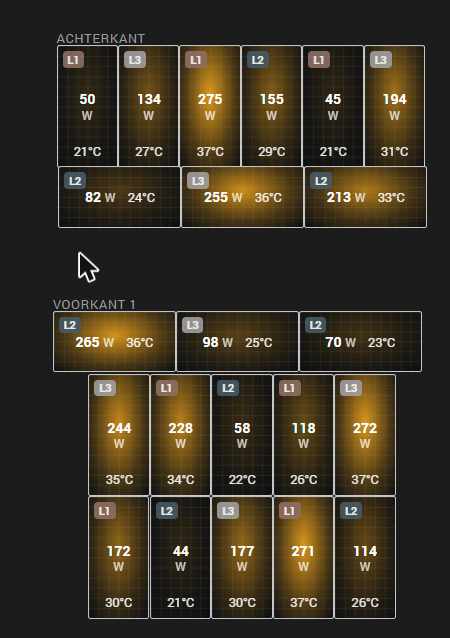

# Enphase Envoy Local

[](https://hacs.xyz/)

A Home Assistant integration that reads an **Enphase IQ Gateway (Envoy)** directly on your own network.
Measurements never go through the cloud; Enlighten is only used to get (and automatically renew) the
owner token that firmware 7 and newer require.



## Features

Everything is read locally from the gateway. Entities are only created for what *your* gateway
actually reports, so a basic system gets a tidy device page and a fully metered one gets everything.

**Gateway**
- Production now / today / total — ready for the **Energy dashboard**
- With production CTs: power, voltage and current per phase (L1–L3)
- With consumption CTs: house consumption, grid power (total and per phase)
- **Grid import and export** (today and total) straight from the gateway's net meter — the Energy
  dashboard's grid section works without a separate P1 meter
- Self-consumption % and self-sufficiency % today
- Grid frequency and power factor
- Enlighten cloud connection, last report to Enlighten, network type and Wi-Fi signal
- Export limit status
- Buttons: **Refresh now**, **Renew token** and **Fetch panel layout**
- Switch **Production on/off** — only appears when the token is allowed to control production
  (Enphase only permits this with an installer token)

**Every microinverter** (its own device, linked to the gateway)
- AC power, DC power, **live efficiency** (AC/DC)
- DC voltage and current, AC voltage, current and frequency
- **Temperature**
- Production today / yesterday / this week / total
- Producing and communicating status, phase (L1–L3), **firmware**, signal strength, status flags

**Panel health**
- Every panel is compared with the median of the other panels on the same roof surface
  (today and over 7 days): sensors *Performance vs. roof* (%), *Underperforming* and *No output*
- Repair notices (Settings → Repairs) for a panel that keeps underperforming, a panel that gives
  nothing for 30 minutes while its neighbours produce, and a gateway that lost Enlighten for 6 hours;
  they clear themselves when the problem is gone. Threshold adjustable in the options (default 90 %)

**Panel layout card** (`custom:enphase-panel-layout-card`, added to your dashboard resources automatically)
- Every panel where it lies on the roof, taken from the array layout in Enlighten
  (falls back to a tidy grouping per phase when there is none)
- Views: **Now** (live power with a sun glow), **Today** (heatmap of kWh per panel), **Health**
  (green/orange/red vs. the roof), **Temperature**, **Efficiency**
- **Replay the day**: a slider and play button show the sun moving over the roof, smoothly
  interpolated per minute; uses any other power sensor of the same microinverter as history fallback
- Underperforming panels get a red outline; click a panel for its history

```yaml
type: custom:enphase-panel-layout-card
title: Zonnepanelen
mode: power        # power | today | health | temperature | efficiency
```

**System summary card** (`custom:enphase-system-card`)
- Solar → home ↔ grid with live power and animated flow, today's production, use, import and
  export, self-consumption and self-sufficiency bars, panels producing, problems, Enlighten status

Both cards appear in the card picker (search for "Enphase") and have a visual editor.

```yaml
type: custom:enphase-system-card
title: Zonnepanelen
```

**Smart about firmware quirks**
- Firmware 8 reports the lifetime counter as "today" and "last 7 days". The integration detects
  this, uses the microinverters' own day counters and keeps its own day counters (stored on disk,
  reset at local midnight). Values that the gateway simply cannot deliver are removed instead of
  staying "unknown".

**Setup and account safety**
- Set up from the UI; gateways are discovered automatically
- Firmware 5/6 (no token) and 7/8 (owner or installer token)
- Token fetched and renewed automatically with your Enlighten e-mail and password, **or** paste a token
- Rejected credentials are never retried by themselves (you get a re-authentication prompt);
  temporary Enlighten problems back off 1 → 2 → 5 → 10 → 30 → 60 minutes
- Diagnostics download with passwords and tokens removed
- Adjustable polling interval (5–300 s, default 10 s); English and Dutch

## Installation

### HACS (recommended)

1. HACS → ⋮ → **Custom repositories** → add this repository's URL, category **Integration**
2. Search for **Enphase Envoy Local**, download it and restart Home Assistant
3. **Settings → Devices & services → Add integration → Enphase Envoy Local**

### Manual

Copy `custom_components/enphase_envoy_local` into the `custom_components` folder of your
Home Assistant configuration and restart.

## Setup

1. Enter the IP address of the gateway (give it a fixed address in your router).
2. Firmware 7+: enter your Enlighten e-mail and password, or paste a token from
   <https://entrez.enphaseenergy.com>. Accounts with two-factor authentication must use a token;
   a pasted token cannot be renewed automatically (it is valid for a year for owners) — you will be
   asked for a new one when it expires.

**Options:** polling interval, sensors per microinverter and the underperformance threshold.

## Energy dashboard

- Solar production: **Production total**
- Grid consumption: **Grid import total**; return to grid: **Grid export total** (needs consumption CTs)
- Per panel: each microinverter's **Production total** can be added as an individual device

**Grid power** is positive when taking power from the grid and negative when exporting.

## What the gateway does not allow

With an owner token the gateway refuses to stop production or change the export limit (HTTP 401);
Enphase reserves that for installers. Per-phase or percentage power limiting of the microinverters
is not available through the local API at all. For zero-export regulation, use the export limit an
installer sets in the gateway, or a battery/inverter system that controls the AC-coupled PV.

## Relation to the built-in Enphase Envoy integration

Home Assistant ships an official `enphase_envoy` integration. This one is a lightweight alternative
with no external Python dependencies, a fixed 10-second default interval and conservative token
handling. Do not set up the same gateway in both integrations at the same time; it doubles the load on
the gateway.

## Troubleshooting

- **Cannot reach the gateway**: check the IP address; open `https://<ip>/info` in a browser
  (accept the certificate warning) — it should show the serial number.
- **Enlighten rejected the e-mail or password**: log in at enlighten.enphaseenergy.com to check them.
- **No token for this serial number**: the gateway is not linked to that Enlighten account.
- Download diagnostics from the device page when opening an issue (passwords and tokens are removed).

This project is not affiliated with or endorsed by Enphase Energy. "Enphase", "Envoy" and "Enlighten"
are trademarks of Enphase Energy, Inc.

## License

MIT
